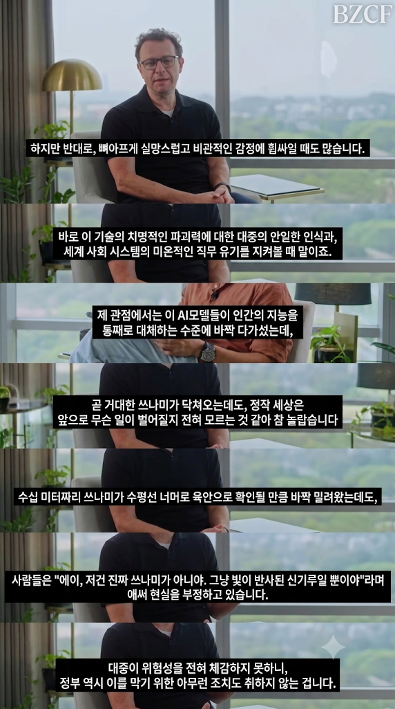
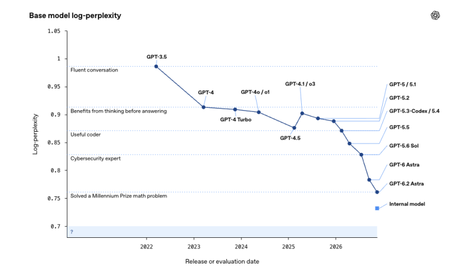

Tipping Point: 어떤 현상이나 변화가 서서히, 미미하게 진행되다가 작은 변화나 요인으로 인해 어느 순간 균형이 깨지며 순식간에 폭발적으로 확산되거나 되돌릴 수 없는 변화로 넘어가게 되는 결정적 순간.

## 어느 순간 남의 이야기가 아니게 된다

나는 작년 겨울쯤부터 단 한 줄의 코드도 직접 짜지 않았다. 코딩에 국한하면 AI와 잘 협업하는 법을 연구하는 게 기존의 업무를 완전히 대체하였다. 신입 개발자 채용이 급감했다는 뉴스는 이제 예전 뉴스가 됐고, 고개를 돌려보니 개고생해서 라이선스를 딴 전문직 친구들마저도 법인에 들어가기가 쉽지 않다고 한다. 취업에 좌절한 청년들이 '꿈꾸던 어른이 되었나요?'를 들으며 서로를 위로하고, 그 AI 음원은 멜론에서 1위를 찍었다.

멀리서 들리던 소문이 어느 순간 남의 이야기가 아니게 된다.

올해 수능날의 풍경은 평년과 많이 달랐다. 난이도와 등급컷보다 리트냥이의 마지막 일주일이 뉴스를 도배했다. 요즘 기준으로 수능 만점을 받는데 필요한 AI 토큰 비용은 1~6 달러 수준이라고 한다. 정부가 짧은 시간에 온갖 대책을 마련했지만 과연 문제없이 치뤄졌을까? 현재의 시험 시스템은 과거 유물이 되고 있다는 걸 모두가 느끼고 있다.

변화는 서서히 조용히 진행되고, 어느새 파도가 되어 우리를 덮친다. 기존 질서의 해체는 이미 하나둘 진행되고 있었다. 그저 이번 차례가 ‘시험의 공정성’과 ‘시험 결과에 대한 신뢰’라는 한국 사회의 뇌관이었을 뿐이다. 우리 사회는 이 두 가지를 바탕으로 누구에게 얼마나 많은 사회적 기회를 배분할지 결정해 왔다. 개인에게 시험은 무엇을 준비하면 어떤 기회에 가까워지는지 알려주는 장치이기도 했다. 좋은 학교에 가고, 자격을 얻고, 경력을 쌓으면 안정된 삶에 가까워질 수 있다는 기대가 수많은 선택의 기준이 되어왔다.

## 구명조끼만으로 쓰나미를 버틸 수 있을까

1\) 미국의 AI 기반 로펌 Crosby는 반복적인 상업계약의 1차 검토와 수정안 작성을 AI에 맡기고, 변호사가 판단과 최종 검토를 담당한다. 계약 업무를 처리하는 방식이 변하고 있고, 고객에게는 문서별로 사전에 정한 요금을 받는다. 서비스 원가가 저렴해지고 경쟁이 치열해지면, 시간당 과금 대비 건별 정액 자문의 비중이 더 커질 가능성도 높다.

국내에선 태평양이 Harvey를 전 구성원에게 도입했다. 같은 품질의 검토에 필요한 사람의 시간과 비용이 줄어든다면, 로펌은 업무를 나누고 인력을 배치하는 방식을 다시 검토하게 될 것이다. 이는 변호사를 몇 명 고용하고, 어떤 일을 맡기고, 어떤 능력에 보상할지에도 영향을 줄 수 있다.

2\) 2026년 11월 20일, 앤트로픽 소속 수학자 레벤트 알푀게가 Claude와 함께 리만가설의 증명을 찾았다고 발표하였다. 지금 상황을 보면 정말 리만가설이 해결되는 듯한 흐름이다. 흥분되기도 하고 두렵기도 하다. 이건 한국의 입시 문제나 매년 수백~천 단위로 합격자가 나오는 시험의 수준이 아니다. 이러한 추세라면 현재 알려진 수학 난제들이 대부분 해결되는데 오랜 시간이 걸리지 않을거라고 한다.

불과 한 달여 전, 필즈상 수상자 테렌스 타오는 리만가설 수준의 수학 증명에서는 AI가 2050년쯤에 더 진전이 있을 거라는 취지의 인터뷰를 했다. 그로부터 한 달 만에 리만가설이 정복되고 있다. 특정 분야에서 가장 똑똑한 사람이라 여겨지는 사람도 자기 분야에 AI가 미칠 파급력을 가늠하지 못한 사례이다.

생명과학 연구도 exponential한 추세로 주요 문제들이 해결되고 있다. 공통점은 AI 에이전트들이 기존 인간과 다른 지능의 특성으로 문제를 해결해버리고, 이제 사람은 작업 목표와 가이드라인을 주고 사후적으로 검증하는 역할로 이동하고 있다는 점이다.

주식시장에서는 현재 오픈AI, 앤트로픽의 ARR이 어떻니를 논하지만.. AI 없었던 시절로 이제는 절대 못돌아간다. 위와 같은 연구 성과가 본격적으로 상용화되기 전에도, 새 모델 공개나 가격 정책, Token Reset 같은 프로모션에 따라 단기 지표의 기울기는 달라질 수 있다. 그리고 프론티어랩들은 이제 최선단 모델은 연구소 바깥으로 공개하지도 않고 있다.

‘어떻게 해야 부정행위를 막을까’, ‘올해 신입을 얼마나 채용해야 할까’, ‘AI 시대에는 무엇을 어떻게 평가해야 할까’...이 뒤에 수백가지 질문이 기다리고 있다. 기술 변화는 이미 우리가 물어야 할 질문도, 질문의 전제도 모두 바꾸고 있다. 우리가 믿어왔던 전문성의 역할과 경제적 가치가 해체되고 있음을 더더더 심각하게 받아들여야 한다.

수능과 전문직 시험 체계를 개편한다는 것은 우리 사회가 기회와 권한을 나누는 기준을 바꾸는 일이다. 기존 기준을 믿고 준비한 사람들의 기대와 앞으로 진입할 사람들의 기회가 함께 걸려 있다. AI가 더 많은 부를 만들어낸다고 해도, 상대적으로 좋은 자리와 권한, 사회적 인정은 여전히 희소할 수 있다. 우리는 무엇을 근거로 기회와 보상을 나누고, 그 결과를 정당하다고 받아들이게 될까.

이 변화는 한국 사회가 공유해 온 성공의 기준과, 좋은 삶에 대한 개인의 가치관에까지 닿아있다.

시험 부정행위로 모인 관심이 우리가 당연하게 받아들여 온 제도와 삶의 경로를 돌아보는 논의로 이어지길 소망한다.
